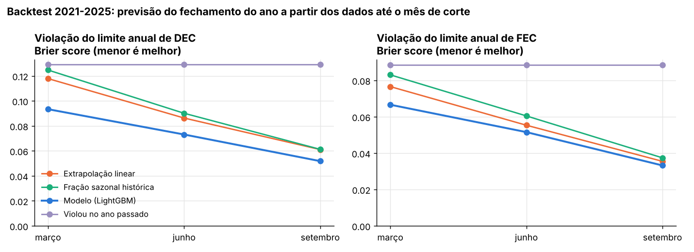
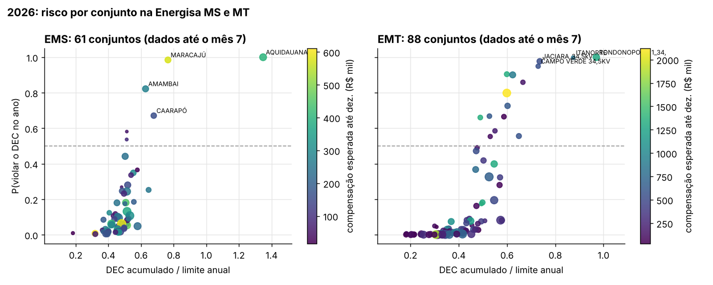
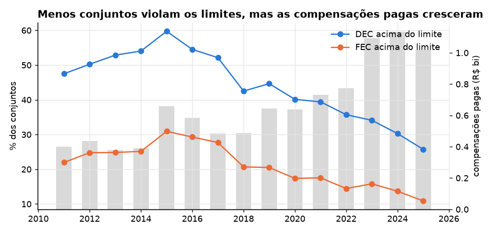

# Monitor de risco regulatório de continuidade (DEC/FEC)

[](https://github.com/CaioNepomuceno2/continuity-risk-monitor/actions/workflows/ci.yml)
[](https://github.com/CaioNepomuceno2/continuity-risk-monitor/actions/workflows/monitor.yml)

-0b7a75)

**No meio do ano, quais conjuntos de unidades consumidoras vão estourar o limite anual de DEC/FEC até
dezembro, com que probabilidade, e quanto isso deve custar em compensações? Onde agir agora?**

Um robô mensal baixa os indicadores abertos da ANEEL dos **~3.200 conjuntos de todas as distribuidoras do
Brasil** e calcula, para cada conjunto, a probabilidade de fechar o ano acima do limite e o R$ de compensação
esperado até dezembro. O resultado sai em CSV, num painel Streamlit e num modelo estrela pronto para o
Power BI.

## Resultados em uma tela

Backtest 2021-2025: para cada ano, o modelo é treinado só com anos anteriores e recebe apenas os meses até
o corte. A taxa média de violação do limite de DEC no período foi de 33%.

| Violação do limite de DEC, corte em **junho** | Modelo | Extrapolação linear | Fração sazonal histórica | "Violou no ano passado" |
|---|---|---|---|---|
| AUC | **0,960** | 0,951 | 0,945 | 0,886 |
| Brier score (menor é melhor) | **0,073** | 0,086 | 0,090 | 0,129 |
| Erro de calibração (ECE) | **0,027** | 0,064 | 0,056 | 0,065 |
| Precisão dos conjuntos sinalizados | **85%** | 77% | 79% | 68% |
| Recall (violações identificadas) | 84% | **88%** | 85% | 80% |

* **Em junho, o modelo identifica 84% das violações de DEC do ano, e 85% dos conjuntos que ele sinaliza de
  fato violam.** A extrapolação linear acha um pouco mais (88%), mas erra mais: só 77% dos alertas dela se
  confirmam.
* **A vantagem é maior cedo no ano.** Em março, o Brier cai de 0,118 (extrapolação) para 0,093 (−21%), e a
  precisão sobe de 61% para 81%. Em setembro, com o ano quase fechado, as regras simples praticamente
  alcançam o modelo.
* O modelo tem o melhor AUC e o melhor Brier em cada um dos cinco anos de teste no corte de junho
  ([`reports/backtest_por_ano.csv`](reports/backtest_por_ano.csv)).
* **A probabilidade é bem calibrada** (ECE de 0,03 contra 0,06 das regras convertidas em probabilidade), o que
  permite somar probabilidades em "violações esperadas". Na faixa de 40% a 85%, o modelo superestima o risco
  em cerca de 5 a 10 pontos ([`reports/figures/02_calibracao_junho.png`](reports/figures/02_calibracao_junho.png)).



**O que isso significa:** em junho, de cada 20 conjuntos que o modelo aponta, 17 violam o limite até dezembro. A
extrapolação acerta 15 em 20 e sinaliza mais conjuntos para achar um pouco mais de violações.

### 2026 (execução de 02/11/2026; dados até junho, julho ou agosto, conforme o conjunto)

| | |
|---|---|
| Conjuntos monitorados | 3.177 |
| Violações esperadas no ano | **840 de DEC** e 381 de FEC |
| Conjuntos com P(violar DEC ou FEC) ≥ 50% | **831**, dos quais **681 ainda estão dentro do limite** (dá para agir) |
| Compensações já pagas no ano | R$ 596,9 mi |
| Compensações esperadas até dezembro | R$ 486,7 mi (o modelo subestimou o total em ~15% no backtest) |

**Energisa MS e MT:**

| | Energisa MS | Energisa MT |
|---|---|---|
| Conjuntos | 61 | 88 |
| Conjuntos com risco alto (P ≥ 50%) | 7 (1 já acima do limite: Aquidauana) | 15 (todos ainda dentro do limite) |
| Violações de DEC esperadas | 10,5 | 17,0 |
| Compensação esperada até dezembro | R$ 13,1 mi | **R$ 38,9 mi** (4ª maior do país) |



A lista completa, conjunto a conjunto, está em [`reports/energisa_ms_mt_2026.csv`](reports/energisa_ms_mt_2026.csv)
e o resumo que o robô publica todo mês, em [`reports/resumo.md`](reports/resumo.md). Os números de 2026
acima são da execução de 02/11/2026; os arquivos em `reports/` são regravados pelo robô a cada mês (e variam
na terceira casa entre execuções, pelo paralelismo do LightGBM).

A metodologia completa (definições, fórmulas, desenho do backtest, métricas e premissas) está em
[`docs/metodologia.md`](docs/metodologia.md).

## Na prática: o que muda para quem decide

### O problema hoje

O acompanhamento de DEC e FEC costuma ser feito numa planilha com o acumulado do ano e uma extrapolação até
dezembro. Esse é exatamente o baseline "extrapolação linear" do backtest, e ele tem três problemas:

* **Muito alarme falso cedo no ano.** Em março, a extrapolação sinaliza em média **1.473 conjuntos por ano** no
  país, dos quais **565 não violam** (38%). Com tanto alerta, a equipe não consegue priorizar.
* **O dado público chega tarde.** Na execução de 02/11/2026, os indicadores publicados iam até junho, julho ou
  agosto, conforme o conjunto. Quem só olha a base da ANEEL perde de 3 a 5 meses.
* **O limite coletivo não conta a história toda.** As compensações somam cerca de **R$ 1 bi por ano** no país, e
  **46% delas saem de conjuntos que fecham o ano dentro do limite de DEC**, porque a compensação é calculada por
  consumidor.

### O que se ganha

Médias por ano do backtest 2021-2025, limite de DEC, todas as distribuidoras
([`reports/resumo_decisao.csv`](reports/resumo_decisao.csv)):

| Ganho | Quanto | De onde vem o número |
|---|---|---|
| Menos alarme falso em março | 181 alarmes falsos por ano contra 565 da extrapolação (−68%), com 81% de precisão contra 61% | **Medido** no backtest (precisão média por ano, como na tabela acima) |
| Menos alarme falso em junho | 153 contra 262 (−42%), com 85% de precisão contra 77% | **Medido** no backtest (idem) |
| Lista acionável | em junho, 849 conjuntos sinalizados ainda estão **dentro do limite**, e 695 deles de fato violam até dezembro | **Medido** no backtest |
| Antecedência | 9 meses com o alerta de março e 6 com o de junho | **Desenho:** mês do corte |
| R$ em jogo | os conjuntos sinalizados em junho pagam R$ 235 mi de compensação de julho a dezembro, metade dos R$ 475 mi do país no período | **Medido:** compensação paga depois do corte |
| Probabilidade utilizável | ECE de 0,03 contra 0,06 das regras: dá para somar probabilidades em "violações esperadas" e escolher o limiar | **Medido** no backtest |

**O custo da troca:** o modelo é mais conservador. Em junho ele deixa passar 167 violações por ano, contra 127 da
extrapolação; em março, 234 contra 122. Se deixar passar custa muito mais que inspecionar, basta baixar o
limiar de alerta (ajustável no painel).

O monitor não reduz o DEC sozinho. O ganho é saber cedo, com poucos alarmes falsos, **onde** as ações de
manutenção, poda e reforço de equipe ainda podem mudar o fechamento do ano. Quanto cada ação evita não foi
medido aqui; para religadores, o projeto
[`automation-impact`](https://github.com/CaioNepomuceno2/automation-impact) mede o efeito.

### Por que aplicar

* **Compensação é automática e por consumidor.** Pelo PRODIST Módulo 8, a distribuidora compensa o consumidor
  quando os indicadores individuais (DIC, FIC, DMIC, DICRI) passam do limite. A conta é de cerca de R$ 1 bi por
  ano no país e R$ 38,9 mi esperados só na Energisa MT até dezembro de 2026.
* **Os limites coletivos são públicos e comparados.** A ANEEL fixa limites de DEC e FEC por conjunto e publica o
  desempenho de cada distribuidora.
* **Ação leva tempo.** Poda, inspeção, manutenção corretiva e reposicionamento de equipes precisam de meses.
  Um alerta em março ou junho cabe nesse prazo; um alerta em outubro, não.

### Como aplicar (roteiro de adoção)

1. **Trocar ou complementar os dados públicos por dados internos.**
   * DEC e FEC apurados pelo sistema de qualidade ou pelo OMS, por dia ou semana, antes da publicação na ANEEL.
     Isso elimina os 3 a 5 meses de atraso.
   * **Telemetria de religadores e subestações:** cada abertura de religador ou disjuntor, com horário e
     consumidores a jusante, dá o DEC parcial do mês corrente em tempo quase real. Também mostra quais
     alimentadores e equipamentos estão gerando o DEC do conjunto, ou seja, onde agir.
   * DIC e FIC por consumidor, para prever a compensação diretamente, já que quase metade dela sai de conjuntos
     dentro do limite.
2. **Calibrar:** o limiar de alerta (P ≥ 0,5 por padrão) deve refletir o custo de uma ação contra o custo de uma
   violação. Com dados internos, retreinar com o mesmo código (`scripts/robo.py --backtest`) e conferir as
   métricas.
3. **Piloto de um semestre, em paralelo:** rodar o monitor de março a setembro ao lado do acompanhamento atual
   e comparar as duas listas a cada mês. Os indicadores são alarmes falsos, violações perdidas, antecedência do
   alerta e R$ de compensação nos conjuntos sinalizados.
4. **Rotina:**
   * o robô roda todo dia 5 no GitHub Actions, e o mesmo `scripts/robo.py` roda em qualquer servidor ou
     agendador de RPA interno;
   * no Power BI, basta conectar a pasta `powerbi/` (seção 4): a tabela `fato_previsao` já traz, por conjunto, a
     probabilidade, a folga até o limite e o R$ esperado;
   * quem usa: a regulação (metas e compensações), a operação e manutenção (onde mandar poda, inspeção e
     equipes) e o planejamento (onde o problema se repete todo ano e pede investimento).
5. **Critérios de sucesso:**
   * violações evitadas entre os conjuntos sinalizados que receberam ação, comparados com sinalizados
     parecidos que não receberam;
   * alarmes falsos por mês;
   * meses de antecedência;
   * R$ de compensação contra o ano anterior.

### Limites de uso

* **Não diz a causa** nem qual ação tomar: diz onde o risco está.
* **A probabilidade superestima** o risco em 5 a 10 pontos na faixa de 40% a 85%.
* **O R$ esperado é piso:** no backtest, o total do país foi subestimado em cerca de 15%.
* **Com dados públicos, o alerta chega atrasado** e pode mudar quando a distribuidora revisa meses passados.

## 1. O que o histórico mostra



* A fração de conjuntos acima do limite de DEC caiu de **60% em 2015 para 26% em 2025**, mas as compensações
  pagas subiram de R$ 0,66 bi para **R$ 1,0 a 1,1 bi por ano em 2023-2025** (valores nominais).
* O motivo é que a compensação é **individual** (DIC, FIC, DMIC, DICRI por consumidor), não coletiva:
  **46% das compensações de 2021-2025 foram pagas em conjuntos que fecharam o ano abaixo do limite de DEC**
  ([`reports/compensacao_vs_violacao.csv`](reports/compensacao_vs_violacao.csv)). Ainda assim, o valor médio
  por conjunto cresce com o DEC: R$ 85 mil/ano nos conjuntos abaixo de 50% do limite e R$ 979 mil/ano nos
  acima de 2 vezes o limite.

**O que isso significa:** olhar só o DEC do conjunto contra o limite deixa de fora quase metade da conta de
compensações. Para gerenciar o R$, é preciso acompanhar também os indicadores individuais.

## 2. Previsão de compensação

Para o R$ de compensação de m+1 a dezembro, o modelo tem o menor erro absoluto por conjunto nos três cortes
([`reports/backtest_compensacao.csv`](reports/backtest_compensacao.csv)):

| Erro absoluto médio por conjunto | Março | Junho | Setembro |
|---|---|---|---|
| Modelo (LightGBM Tweedie) | **R$ 93 mil** | **R$ 73 mil** | **R$ 51 mil** |
| Extrapolação linear do pago no ano | R$ 162 mil | R$ 85 mil | R$ 55 mil |
| Média dos últimos 5 anos | R$ 101 mil | R$ 81 mil | R$ 57 mil |

No total do país, o modelo **subestima** o restante do ano em ~15% (o valor cresceu ano a ano no período).
Por isso o R$ esperado de 2026 deve ser lido como piso.

**O que isso significa:** em março, a extrapolação do pago até então erra quase o dobro do modelo (R$ 162 mil
contra R$ 93 mil por conjunto), porque as compensações se concentram em certos meses. O modelo usa o perfil
histórico de cada conjunto.

## 3. O robô

[`.github/workflows/monitor.yml`](.github/workflows/monitor.yml) roda **todo dia 5, às 06:17 de Brasília**
(também manualmente, com a opção de refazer o backtest):

1. baixa do CKAN da ANEEL os indicadores coletivos, as compensações e os limites ([`src/contrisk/download.py`](src/contrisk/download.py))
   e guarda uma cópia datada do que mudou desde a execução anterior (parágrafo abaixo);
2. monta a base mensal por conjunto e o painel de features até o último mês publicado;
3. treina com todos os anos fechados e prevê o ano corrente (média de 3 sementes);
4. regrava `reports/` (CSVs, `resumo.md`, `status.json`, figuras) e `powerbi/`, e faz commit se algo mudou.

**Cópia datada dos downloads.** A ANEEL regenera os arquivos (em 05/11/2026, os cinco maiores foram gerados de novo
ao longo do dia) e as distribuidoras revisam meses passados. A cada execução, o robô guarda os arquivos brutos que
mudaram desde a cópia anterior, para formar com o tempo a base "como foi publicada". Um ciclo completo tem **430 MB**
baixados e **381 MB** guardados (CSV em gzip, Parquet idêntico ao original). Por isso a cópia vai para *assets* de uma
release do GitHub (`dados-aneel-AAAAMMDD-HHMM`), e só um manifesto de uns 2 KB por mês
([`snapshots/manifesto.csv`](snapshots/manifesto.csv): data, sha256, tamanho) entra no git. **Tamanho esperado: cerca
de 2,1 GB por ano se só os três arquivos que a ANEEL atualiza todo mês mudam, até cerca de 4,6 GB se mudam todos**,
mais 381 MB na primeira cópia. A escolha, as medições e as proteções do robô estão em
[`docs/dados.md`](docs/dados.md).

O mesmo comando roda local:

```bash
python scripts/robo.py                  # download + previsão + relatórios + Power BI
python scripts/robo.py --sem-download   # usa data/raw
python scripts/robo.py --backtest       # também refaz o backtest 2021-2025 (~8 min)
```

O CI ([`ci.yml`](.github/workflows/ci.yml)) roda `ruff` e `pytest` sem baixar dados.

## 4. Modelo de dados para Power BI

`powerbi/` traz um modelo estrela em Parquet (3,5 MB), regravado pelo robô todo mês:

| Tabela | Grão | Chaves | Conteúdo |
|---|---|---|---|
| `fato_indicador_mensal` | conjunto × mês (2020+) | `conjunto_id`, `data_id` | DEC, FEC, consumidores, R$ de compensação |
| `fato_previsao` | conjunto, ano corrente | `conjunto_id`, `data_id` (último mês com dado) | acumulados, limites, projeção linear, P(violar DEC/FEC), R$ esperado, folgas |
| `dim_conjunto` | conjunto | `conjunto_id` | nome, distribuidora, consumidores, limites do ano |
| `dim_distribuidora` | distribuidora | `agente` | sigla, destaque (EMS/EMT) |
| `dim_tempo` | mês | `data_id` (AAAAMM) | ano, mês, data, trimestre |

No Power BI: *Obter dados → Parquet* (ou a pasta `powerbi/` pelo conector de pasta), relacionar os fatos com
`dim_conjunto` por `conjunto_id` e com `dim_tempo` por `data_id`, e `dim_conjunto` com `dim_distribuidora` por
`agente`. Para ler direto do GitHub, use a URL *raw* de cada arquivo.

## 5. Painel

```bash
pip install -e ".[app]"
streamlit run app/app.py
```

Filtro por distribuidora, limiar de risco ajustável, ranking das distribuidoras, tabela de conjuntos
priorizados e o DEC acumulado de cada conjunto, ano a ano, contra o limite.

## Como funciona

* **Alvo:** DEC (ou FEC) anual do conjunto, a soma dos 12 meses publicados, acima do limite anual da ANEEL.
* **Features no mês de corte *m* do ano *y*:** acumulado até *m*, últimos 3 meses, compensações já pagas,
  projeções linear e sazonal, perfil histórico do conjunto nos 5 anos anteriores (fração do ano realizada até
  *m*, DEC do restante do ano), fechamentos e violações de *y-1* e *y-2*, limite de *y* e sua variação, porte e
  distribuidora. Nada de *m+1* em diante (teste em [`tests/test_contrisk.py`](tests/test_contrisk.py)).
* **Modelos:** LightGBM binário para cada indicador e LightGBM Tweedie para o R$ de compensação do restante do
  ano, treinados com todos os meses de corte dos anos anteriores.
* **Baselines:** extrapolação linear do acumulado, projeção pela fração sazonal histórica do conjunto e
  "violou no ano passado". Para comparar calibração, cada regra é convertida em probabilidade por uma
  regressão logística ajustada só no treino.

As decisões de dados (composição do DEC publicado, anualização, compensações, limites) estão em
[`docs/dados.md`](docs/dados.md).

## Estrutura

```
src/contrisk/
  download.py   download dos arquivos do CKAN da ANEEL
  build.py      base mensal: DEC, FEC, consumidores, compensações e limites por conjunto
  features.py   fechamento anual, acumulados e painel conjunto × ano × mês de corte (sem vazamento)
  model.py      classificadores, modelo de compensação, baselines, backtest e métricas
  report.py     relatórios, figuras, resumo.md e modelo estrela do Power BI
  snapshot.py   cópia datada dos downloads brutos (hash, gzip do CSV, release e manifesto)
scripts/robo.py   o robô (CLI usada pelo workflow mensal)
scripts/snapshot.py   publica a cópia datada dos dados brutos (assets de release + manifesto)
scripts/resumo_decisao.py   alarmes falsos, conjuntos acionáveis e R$ por método (a partir do backtest)
docs/             decisões de dados e metodologia
app/app.py        painel Streamlit
powerbi/          modelo estrela em Parquet
reports/          saídas versionadas (CSV, JSON, Markdown, figuras)
snapshots/        manifesto das cópias datadas dos downloads brutos (os arquivos ficam em releases)
```

## Reproduzir

```bash
pip install -e ".[dev]"
python scripts/robo.py --backtest   # ~1 GB de download da ANEEL + backtest + previsão
python scripts/resumo_decisao.py    # indicadores de decisão a partir do backtest
pytest
```

## Limitações

* **Compensação individual, limite coletivo.** A relação entre violar o limite de DEC/FEC do conjunto e o R$
  pago é empírica: quase metade das compensações sai de conjuntos dentro do limite. O modelo de compensação
  aprende essa relação, mas ela não é uma regra regulatória.
* **Dados revisados.** O backtest usa a base atual, em que meses passados podem ter sido revisados pelas
  distribuidoras depois da publicação inicial. Em tempo real, o acumulado do ano pode estar incompleto ou ser
  corrigido depois. O robô agora guarda uma cópia datada de cada download, mas o backtest "como foi publicado"
  só será possível depois de alguns meses de cópias: ainda não foi feito.
* **Momento da compensação.** As compensações entram no mês em que foram informadas; pagamentos anuais e
  trimestrais se concentram em meses específicos, o que deixa o R$ esperado mais incerto em cortes precoces.
* **O total de compensações é subestimado** em ~15% no backtest, porque o valor cresceu ano a ano.
* **"Violações esperadas"** soma probabilidades, e `p_viol_qualquer` supõe independência entre DEC e FEC (os
  dois são correlacionados; o número é uma aproximação).
* **Sem causas.** O monitor diz onde o risco está, não por quê; o diagnóstico de causas e de onde investir fica
  com projetos como [`distribution-asset-risk`](https://github.com/CaioNepomuceno2/distribution-asset-risk)
  e [`automation-impact`](https://github.com/CaioNepomuceno2/automation-impact).
* Não trata impactos tarifários (por exemplo, componentes de qualidade na revisão tarifária).

---
Autor: **Caio Nepomuceno**. Dados públicos da ANEEL. Projeto independente, sem vínculo com a ANEEL ou com
qualquer distribuidora.
